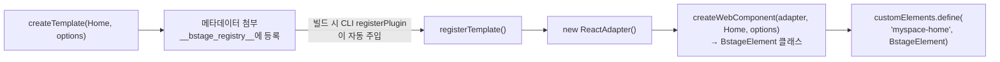

# bstage Template SDK API Reference

SDK를 구성하는 Core, React, Host 패키지의 public API를 정리한 문서입니다. 각 API의 시그니처, 파라미터, 사용 예시를 확인할 수 있습니다.

설계 배경과 동작 원리는 [SDK_ARCHITECTURE.md](./SDK_ARCHITECTURE.md)를 참고하세요.

---

## 1. Core

### 1.1 FrameworkAdapter

모든 프레임워크 바인딩이 구현하는 인터페이스입니다.

```typescript
interface FrameworkAdapter<Component = unknown> {
  mount(
    component: Component,
    container: ShadowRoot | HTMLElement,
    props: Record<string, unknown>,
    bridge: PlatformBridge,
  ): void
  update(props: Record<string, unknown>): void
  unmount(): void
}
```

| 메서드    | 설명                                                               |
| --------- | ------------------------------------------------------------------ |
| `mount`   | Shadow DOM 내에 프레임워크 루트를 생성하고 컴포넌트를 렌더링합니다 |
| `update`  | 새로운 props로 컴포넌트를 갱신합니다                               |
| `unmount` | 프레임워크 루트를 정리하고 참조를 해제합니다                       |

### 1.2 createWebComponent

FrameworkAdapter를 받아 `BstageElement` (HTMLElement 서브클래스)를 생성합니다. Custom Element 등록(`customElements.define`)은 하지 않으며, 프레임워크 바인딩이 처리합니다.

```typescript
function createWebComponent<C>(
  createAdapter: () => FrameworkAdapter<C>,
  component: C,
  options: TemplateOptions,
): typeof HTMLElement
```

**파라미터:**

| 파라미터        | 타입                        | 설명                             |
| --------------- | --------------------------- | -------------------------------- |
| `createAdapter` | `() => FrameworkAdapter<C>` | 어댑터 팩토리 함수               |
| `component`     | `C`                         | 렌더링할 프레임워크 컴포넌트     |
| `options`       | `TemplateOptions`           | 템플릿 메타데이터 (name 필수 등) |

**반환값:** `typeof HTMLElement` — BstageElement 클래스

**BstageElement 라이프사이클:**

| 시점                   | 동작                                                       |
| ---------------------- | ---------------------------------------------------------- |
| `constructor`          | Shadow DOM 생성 (`attachShadow({ mode: 'open' })`)         |
| `connectedCallback`    | adapter 생성 → bridge 생성 → adapter.mount() → 렌더링 시작 |
| `disconnectedCallback` | adapter.unmount() → bridge.destroy() → 참조 해제           |

CLI가 빌드 시 소스 코드에서 `createTemplate()` 호출을 파싱해 빌드 결과물 경로를 정합니다 (`packages/cli/src/vite/metaPlugin.ts`).

### 1.3 PlatformBridge

템플릿과 플랫폼 사이의 양방향 통신을 담당합니다. CustomEvent 기반이며, 모든 이벤트는 `bstage:{type}` 접두사를 사용합니다.

**Template → Platform** (`bridge.emit`)

| 이벤트          | 페이로드                           | 용도                      |
| --------------- | ---------------------------------- | ------------------------- |
| `navigate`      | `{ path, params? }`                | 앱 내 경로 이동           |
| `go-back`       | `{}`                               | 이전 화면으로 돌아가기    |
| `open-external` | `{ url }`                          | 외부 URL을 새 탭으로 열기 |
| `navigate-external` | `{ url }`                      | 같은 탭에서 외부 https 사이트로 이동. 플랫폼이 확인 창을 띄우고 거절할 수 있음 |
| `toast`         | `{ message, duration?, variant? }` | 토스트 메시지 표시        |
| `call-bridge`   | `{ type, payload? }`               | 네이티브 앱 브릿지 호출 요청 |

Template → Platform 이벤트는 `bubbles: true, composed: true`로 Shadow DOM 경계를 넘어 전파됩니다.

**Platform → Template** (`bridge.on`)

| 이벤트                | 페이로드                  | 용도                                                         |
| --------------------- | ------------------------- | ------------------------------------------------------------ |
| `slot.init`           | `{ resourceId? }`         | (옛 슬롯) 슬롯 초기화. resourceId가 있으면 수정 모드, 없으면 생성 모드 |
| `slot.context`        | `SlotContextPayload` (자리별 모양은 `SlotContextOf<Id>`) | (현행 슬롯) 호스트가 마운트 때 한 번 보내는 자리 context. 위젯은 `useSlotContext`(2.2절)로 받습니다 |
| `ticket.create.after` | `{ ticketId, productId }` | 디지털 티켓 생성 완료 (운영자 화면 도메인 이벤트)           |
| `admin.connect`       | `{ fetcher, apiBase, baseUrl }` | 옛 운영자 화면 초기화 이벤트. **SDK는 더 이상 받지 않습니다** — 플랫폼이 아직 보내고 있어 타입만 남아 있습니다 |

Platform → Template 이벤트는 `bubbles: false, composed: false`로 해당 템플릿 요소에만 전달됩니다.

**운영자 화면 도메인 이벤트:**

운영자 화면 전용 이벤트는 `adminEvents.ts`의 `ADMIN_EVENT_CATALOG`에서 관리합니다. 네이밍 컨벤션은 `{domain}.{verb}.{when}` 형식이며, `PlatformEventMap`이 `AdminDomainEventMap`을 extends하므로 Bridge/Handle 타입에 자동으로 들어갑니다.

### 1.4 BstageClient

서드파티가 b.stage API를 직접 호출할 수 있는 HTTP 클라이언트입니다. 게이트웨이 base URL 해석, 인증 헤더 자동 포함, 플랫폼 주입 fetch 해석을 맡습니다.

> **경로와 응답 모양의 출처는 게이트웨이 API Reference Doc입니다.** SDK가 OpenAPI 스펙에서 경로 타입을 생성해 자동완성을 제공하던 방식은 걷어냈습니다 — 스펙이 바뀌어도 SDK를 새로 배포해야 반영되는 구조라 실제 API 변경을 따라가지 못했습니다. 응답 타입은 호출 시 제네릭으로 명시하세요.

> **지원 범위: 게이트웨이(`/gw`)를 타는 API.** 사용자 화면 템플릿은 사용자 화면 도메인의 게이트웨이를 PUBLIC 키(`bsp_`)로, 운영자 화면 템플릿은 운영자 화면 도메인의 **운영자 화면 게이트웨이**를 MANAGEMENT 키(`bsm_`) + 운영자 로그인 세션으로 부릅니다. 같은 클라이언트이고 `baseUrl` 기본값이 현재 도메인을 따르므로 코드는 갈리지 않습니다 — 조건·에러는 [GETTING_STARTED.md](./GETTING_STARTED.md) 8절의 "API 호출"을 보세요. 어느 쪽이든 **b.stage kit 콘솔의 API 레퍼런스(사용자/운영자 탭)에 있는 경로만** 씁니다. 목록에 없는 API가 필요하면 임의로 경로를 추측해 호출하지 말고 **반드시 사용자에게 먼저 확인**하세요.

```typescript
const client = new BstageClient({
  appId: 'bsa_xxx',
  appKey: 'bsp_xxx',
  tenantId: 'tenant-xxx',
})
```

**생성자 옵션:**

| 옵션        | 타입                                          | 설명                                                         |
| ----------- | --------------------------------------------- | ------------------------------------------------------------ |
| `appId`     | `string`                                      | 앱 식별자                                                    |
| `appKey`    | `string`                                      | 앱 키(APP KEY). `appKey`·`appSecret` 중 하나는 필요합니다. 콘솔이 발급하고 게이트웨이 `X-BSTAGE-APP-KEY` 헤더로 검증하는 값. **브라우저에 노출되는 값**으로 비밀값이 아닙니다. 사용자 화면 템플릿은 PUBLIC(`bsp_`), 운영자 화면 템플릿은 MANAGEMENT(`bsm_`) 키입니다 |
| `appSecret` | `string` (deprecated)                         | `appKey`의 옛 이름. 값은 같습니다. 둘 다 주면 `appKey`가 우선하며, 0.4.0(공개 배포판 `@bstage-sdk/core` 기준)에서 제거됩니다 |
| `tenantId`  | `string`                                      | 스테이지 ID                                                  |
| `phase`     | `'dev' \| 'qa' \| 'real' \| 'sandbox'` (선택) | 환경. 현재 미사용 (향후 확장용)                              |
| `baseUrl`   | `string` (선택)                               | base URL 직접 지정. 미지정 시 `resolveBaseUrl()`로 자동 결정 |
| `timeout`   | `number` (선택)                               | 요청 타임아웃 (ms)                                           |
| `fetch`     | `FetchFunction` (선택)                        | 커스텀 fetch 함수 주입                                       |

**base URL 결정 (`resolveBaseUrl`):**

| 우선순위 | 값                   | 설명                               |
| -------- | -------------------- | ---------------------------------- |
| 1        | `config.baseUrl`     | 직접 지정                          |
| 2        | `location.origin/gw` | 브라우저 환경에서 현재 호스트 기반 |
| 3        | `/gw`                | fallback (SSR 등)                  |

로컬 개발 시에는 devVitePlugin이 `resolveBaseUrl()`을 localhost 프록시 URL로 치환합니다.

**fetch 함수 결정:**

| 우선순위 | 값                            | 설명                                             |
| -------- | ----------------------------- | ------------------------------------------------ |
| 1        | `config.fetch`                | 직접 지정                                        |
| 2        | `globalThis.__bstage_fetch__` | 플랫폼이 주입 (Authorization, CF Access 헤더 등) |
| 3        | `globalThis.fetch`            | 기본 fetch                                       |

> `config.fetch`를 주지 않으면 `__bstage_fetch__`/`globalThis.fetch`는 **요청 시점에** 해석됩니다. 플랫폼은 이 값을 템플릿 mount 직전에 주입하므로, 모듈 최상단에서 만든 클라이언트(권장 패턴)도 늦은 주입을 놓치지 않습니다.

**HTTP 메서드:**

```typescript
client.get(path, options?)     // GET 요청
client.post(path, options?)    // POST 요청
client.put(path, options?)     // PUT 요청
client.patch(path, options?)   // PATCH 요청
client.delete(path, options?)  // DELETE 요청
```

**옵션:**

| 옵션      | 대상 메서드          | 타입                               | 설명                                          |
| --------- | -------------------- | ---------------------------------- | --------------------------------------------- |
| `path`    | 전체                 | `Record<string, string \| number>` | 경로 템플릿의 `{param}` 치환값 (URL 인코딩됨) |
| `params`  | `get`                | `Record<string, ...>`              | 쿼리 파라미터                                 |
| `body`    | `post`/`put`/`patch` | `unknown`                          | 요청 바디 (JSON 직렬화)                       |
| `headers` | 전체                 | `Record<string, string>`           | 추가 헤더                                     |
| `timeout` | 전체                 | `number`                           | 이 요청만의 타임아웃 (ms)                     |

**사용 예시:**

```typescript
// 응답 타입은 제네릭으로 명시한다. 생략하면 unknown이다.
const menu = await client.get<MenuResponse>('/home/v1/menu')

// Path 파라미터 포함
const post = await client.get<PostResponse>('/content/v1/boards/{boardId}/posts/{postId}', {
  path: { boardId: 'board-1', postId: 'post-1' },
})
```

응답 타입(`MenuResponse` 등)은 게이트웨이 API Reference Doc을 보고 필요한 필드만 프로젝트 안에 선언해 쓰는 것을 권장합니다.

내부적으로 `HttpClient`(Fetch 기반, 인터셉터 지원)를 사용하며, 모든 요청에 `X-BSTAGE-APP-ID`/`X-BSTAGE-APP-KEY`/`X-BSTAGE-TENANT-ID` 헤더를 자동 포함합니다(앱 키가 없으면 `X-BSTAGE-APP-KEY`는 생략되고 생성 시 브라우저 콘솔에 경고가 납니다).

### 1.5 계정 화면 API (`@bstage-sdk/core/account`)

가입·소셜 가입·전화번호 재인증·회원정보 수정처럼 **로그인 상태를 만드는 화면** 전용 API입니다. 일반 템플릿은 쓰지 않습니다
(하위 진입점으로 분리돼 있어 일반 템플릿 번들에는 실리지 않습니다).

같은 번들이 두 환경에서 돕니다.

- **inline**(플랫폼 페이지에 직접 마운트): 계정 API(`/svc/account/...`)를 부르고 로그인 쿠키를 SDK가 씁니다. 기존 템플릿 동작을
  그대로 옮긴 것이라 한계도 같습니다 — 액세스 토큰 쿠키는 JS로 쓰므로 HttpOnly가 아니고, 재인증 인계(호스트 전역)는 같은 페이지의
  다른 inline 스크립트도 먼저 읽을 수 있습니다. 이 한계는 격리 프레임에서 닫힙니다. 가입·로그인 계열 호출에는 남아 있는 옛 액세스 토큰을
  싣지 않고, `completeLogin`은 같은 origin 앱 경로(`/`로 시작, `//` 아님)만 이동합니다.
- **격리 프레임**: 세션 작업을 브리지로 호스트에 맡깁니다. 템플릿은 토큰을 받지 않고, 배치에 `account-session` 권한이 있어야
  동작합니다(`supported`). 권한이 없으면 결과의 `error.bridgeCode`가 `NOT_ALLOWED`입니다.

```ts
import { createAccountClient } from '@bstage-sdk/core/account'

const account = createAccountClient({
  otpGatewayBaseUrl: 'https://otp.example.com', // inline 전용. 격리에서는 호스트가 정한다
})

const signed = await account.signup({ email, password, nickname, agreements })
if (!signed.ok) return showError(signed.error)
const login = signed.status === 'LOGIN_REQUIRED'
  ? await account.loginAfterSignup({ email, password })
  : signed
await account.completeLogin(login) // 성공이면 전체 리로드로 이동
```

| 함수 | 설명 |
| --- | --- |
| `signup(body)` | 이메일 가입. 보통 `status: 'LOGIN_REQUIRED'`를 돌려준다 |
| `signupSocial(body)` | 소셜 가입. OAuth `code`·`state`는 넣지 않는다(SDK·호스트가 페이지 URL에서 채움) |
| `loginAfterSignup({ email, password, turnstileToken? })` | `signup` 직후 같은 이메일로 한 번 |
| `phoneReverify({ countryCallingCode, phone, phoneVerificationToken })` | 재인증. 임시토큰은 SDK·호스트가 보관한 값을 쓴다 |
| `completeLogin(result)` | 로그인된 결과면 전체 리로드로 이동(실패 결과는 무시) |
| `otpSendSignup`·`otpSendPhoneChange`·`otpVerifySignup`·`otpVerifyPhoneChange` | SMS OTP. purpose는 함수로 고정 |
| `hostQuery()`·`hostCountry()`·`spaceInfo()` | 페이지 쿼리(`socialType`)·국가 코드·스페이스 id·제목·법인. 격리 프레임의 스페이스 id는 호스트가 init에 싣는 `spaceId`다(프레임은 쿠키를 읽을 수 없다) |
| `reverificationStatus()`·`releaseReverification()` | 재인증 임시토큰 사용 가능 여부(값은 노출 안 함)·폐기 |

결과는 예외 대신 객체로 돌아옵니다 — 세션 작업은 `{ ok, status?, createdAt?, error?, next? }`, OTP는
`{ ok, status(HTTP, 응답 없음은 0), data?, error? }`. 토큰은 어느 결과에도 담기지 않습니다. React에서는
`@bstage-sdk/react/account`의 `useAccountSession(options)`를 씁니다.

### 1.6 페이지 위치·같은 탭 외부 이동

inline과 격리 프레임에서 같은 시그니처로 동작합니다(`@bstage-sdk/core`).

```typescript
interface PageLocation {
  readonly path: string
  readonly query: URLSearchParams
}

function getPageLocation(): PageLocation
function onPageLocationChange(cb: (loc: PageLocation) => void): () => void
function navigateExternal(url: string): Promise<void>
```

| 함수 | inline | 격리 프레임 |
| --- | --- | --- |
| `getPageLocation()` | `window.location`의 pathname·search(`//`·`/\`로 시작하는 경로는 빈 위치) | 플랫폼이 넘긴 페이지 위치. 플랫폼이 위치를 주지 않는 화면(계정 화면 등)에서는 `path`가 빈 문자열, `query`가 비어 있음 |
| `onPageLocationChange(cb)` | 플랫폼이 `window`에 내는 `bstage:page` 이벤트(`detail: { path, search }`) | 플랫폼의 위치 변경 알림. 해제 함수를 돌려줌. 처음 값은 부르지 않으므로 `getPageLocation()`으로 먼저 읽음 |
| `navigateExternal(url)` | 템플릿 엘리먼트에서 `navigate-external`(`{ url }`) 이벤트. 이 템플릿 엘리먼트가 없거나 여럿 붙어 있으면 reject(여러 곳에 쓰는 템플릿은 `useNavigation().navigateExternal`) | 플랫폼에 같은 탭 이동 요청. 플랫폼이 지원하지 않거나 거절하면 `code`가 붙은 Error로 reject |

- `query`는 호출마다 새로 만든 사본입니다. 쿼리를 바꾸려면 `useNavigation().navigate('/shop?id=1')`(또는
  `bridge.emit('navigate', { path: '/shop?id=1' })`)처럼 경로에 쿼리를 붙여 이동합니다.
- `navigateExternal`은 https URL만 받습니다(아이디·비밀번호가 든 URL 거절). 플랫폼이 확인 창을 띄우고, 사용자가 취소하면
  이동하지 않습니다(이동 여부는 돌려주지 않습니다). 새 탭으로 열려면 `openExternal`을 씁니다.

### 1.7 템플릿 storage

inline과 격리 프레임에서 같은 코드로 쓰는 문자열 저장소입니다(`@bstage-sdk/core`).

```typescript
interface TemplateStorage {
  get(key: string): Promise<string | null>
  set(key: string, value: string): Promise<void>
  remove(key: string): Promise<void>
}

const templateStorage: TemplateStorage
```

| | inline | 격리 프레임 |
| --- | --- | --- |
| 저장 위치 | 브라우저 `localStorage`의 `bstage:tpl:inline:` 아래(쓸 수 없으면 페이지 수명 메모리) | 플랫폼 storage — 페이지·위젯 단위. 플랫폼 설정에 따라 새로고침 뒤에도 남음 |
| 상한 | 키 1~200자·값 4096자(어기면 TypeError) | 같음 + 키 50개. 저장 불가면 `code: 'STORAGE_UNAVAILABLE'` Error |

- 토큰·비밀번호·개인정보는 저장하지 않습니다(플랫폼의 다른 스크립트도 읽을 수 있는 저장소입니다).

---

## 2. React

### 2.1 createTemplate

bstage 메타데이터가 첨부된 React 컴포넌트를 생성합니다. Web Component 등록(`customElements.define`)은 하지 않으며, 빌드 시 CLI의 `registerPlugin`이 자동 주입하는 `registerTemplate()`이 처리합니다.

```typescript
function createTemplate(
  Component: ComponentType<any>,
  options: CreateTemplateOptions,
): BstageTemplateComponent
```

**파라미터:**

| 파라미터    | 타입                    | 설명                                   |
| ----------- | ----------------------- | -------------------------------------- |
| `Component` | `ComponentType<any>`    | React 컴포넌트                         |
| `options`   | `CreateTemplateOptions` | 템플릿 옵션 (name, slot, type, styles) |

**CreateTemplateOptions:**

| 옵션     | 타입              | 설명                                                                                                                                                                                                                                         |
| -------- | ----------------- | -------------------------------------------------------------------------------------------------------------------------------------------------------------------------------------------------------------------------------------------- |
| `name`   | `string`          | Custom Element 태그명 (필수). **소문자 시작 + 하이픈 1개 이상 + 소문자/숫자/하이픈**만 허용. 예: `bmf-hello`. 템플릿마다 달라야 하며, 겹치면 빌드가 막습니다                                                                                   |
| `slot`   | `SlotIdV2` (선택) | **위젯 전용.** 이 위젯이 들어갈 자리. `src/slots/` 아래 템플릿은 필수이고 `src/pages/` 아래에는 쓸 수 없습니다. 카탈로그 id로 좁혀 있어 편집기 자동완성이 뜨고, `bstage build`가 대조해 오타를 막습니다. 예: `'user.contents-home.curation:after'` |
| `type`   | `string` (선택)   | 템플릿 유형 (UI 필터링용)                                                                                                                                                                                                                    |
| `shadow` | `boolean` (선택)  | Shadow DOM 사용 여부 (기본값 `true`). 플랫폼 CSS 격리를 위해 끄지 않는 것을 권장                                                                                                                                                             |
| `styles` | `string` (선택)   | Shadow DOM에 주입할 inline CSS(`index.css?inline` 값). 사용자 화면·운영자 화면 템플릿 모두에 들어갑니다                                                                                                                                       |

> SDK는 `space`(스테이지)·`target`(user/admin) 같은 게시 대상 정보를 옵션으로 받지 않습니다. 이런 값은 콘솔이 빌드를 올릴 때 CDN 경로의 상위 세그먼트에 넣습니다. `space`는 `init`의 레포 네이밍과 BstageClient의 `tenantId` 기본값으로만 쓰입니다.
>
> **페이지·위젯의 자리는 소스 위치가 정합니다.** 페이지는 `src/pages/` 아래 폴더 구조가 곧 페이지 경로이고, 위젯은 `slot` 옵션이 자리를 정합니다. 한 위젯은 한 자리이며 여러 자리에 재사용할 수 없습니다. 자세한 내용은 [BUILD_SYSTEM.md](./BUILD_SYSTEM.md)를 참고하세요.
>
> 풀페이지 레이아웃(topBar/bottomBar)은 콘솔이 소유하므로 템플릿 옵션에서 받지 않습니다.

**내부 흐름:**



`registerTemplate()` 내부에서 `ReactAdapter`가 생성되며, Shadow DOM 내에 React Root를 생성하고, `BstageContext.Provider`로 bridge를 하위 트리에 제공합니다.

### 2.2 Hooks

| Hook                      | 반환 타입                            | 역할                                                               |
| ------------------------- | ------------------------------------ | ------------------------------------------------------------------ |
| `useNavigation()`         | `{ navigate, goBack, openExternal, navigateExternal }` | bridge.emit 래퍼 — 네비게이션 관련 동작. `navigateExternal`은 같은 탭 외부 이동(1.6절) |
| `usePageLocation()`       | `{ path, query }`                    | 페이지 위치 구독(`getPageLocation`·`onPageLocationChange` 래퍼, 1.6절) |
| `usePlatformEvent()`      | `void`                               | 플랫폼 → 템플릿 이벤트 구독. 마운트 시 구독, 언마운트 시 자동 해제 |
| `useLocale()`             | `{ current: LanguageCode }`          | 현재 렌더 로케일 구독. 언어 변경(SPA 전환)에 reactive              |
| `useMessages()`           | `(key, params?) => string`           | 로컬 메시지 사전 기반 번역 함수. 키는 객체에서 TS 추론             |
| `useBstageTranslations()` | `{ current, t, ready }`              | 플랫폼 공용 번역 사전(`Bxxxxx`) fetch + 해석 (+ 현재 로케일)       |
| `useBstageContext()`      | `{ bridge }`                         | bridge 원시 접근                                                   |
| `useSlotContext<Id>()`    | `SlotContextOf<Id> \| undefined`     | 위젯이 호스트가 보낸 자리 context(`slot.context`)를 받음. 받기 전에는 `undefined` |
| `useShadowStyle(css)`     | `RefObject<T>`                       | 반환한 ref를 붙인 요소의 ShadowRoot에 CSS를 렌더 중에 주입(같은 CSS는 한 번만) |

> 로케일 훅 3종(`useLocale`/`useMessages`/`useBstageTranslations`)은 **`BstageLocaleProvider` 하위에서** 호출해야 합니다(밖이면 throw) — 아래 [BstageLocaleProvider](#bstagelocaleprovider)를 참고하세요.

**usePlatformEvent**

```typescript
function usePlatformEvent<T extends PlatformEventType>(
  type: T,
  handler: (payload: PlatformEventMap[T]) => void,
): void
```

| 파라미터  | 타입                                     | 설명                         |
| --------- | ---------------------------------------- | ---------------------------- |
| `type`    | `PlatformEventType`                      | 구독할 이벤트 타입           |
| `handler` | `(payload: PlatformEventMap[T]) => void` | 이벤트 수신 시 호출되는 콜백 |

```tsx
usePlatformEvent('slot.init', (payload) => {
  setResourceId(payload.resourceId)
})

usePlatformEvent('ticket.create.after', ({ ticketId, productId }) => {
  saveCustomField(ticketId)
})
```

BstageContext가 없는 환경(로컬 dev 등)에서는 아무 동작도 하지 않습니다. handler가 바뀌어도 재구독하지 않으므로 인라인 함수를 안전하게 넘길 수 있습니다.

**useSlotContext**

```typescript
function useSlotContext<Id extends SlotIdV2>(): SlotContextOf<Id> | undefined
```

호스트가 마운트 때 한 번 보낸 자리 context(`slot.context`)를 받습니다. 위젯이 ready 신호를 보내기 전에 호스트가 보냈어도 `TemplateHandle`이 버퍼링했다가 ready 때 다시 보내므로, 위젯은 마운트 후 한 번 받습니다. 호스트 → 위젯 단방향 읽기 전용이라, 마운트 이후 호스트 데이터가 바뀌어도 다시 오지 않습니다. 받기 전(또는 호스트가 보내지 않은 경우)에는 `undefined`이므로 가드가 필요합니다.

`Id`는 위젯의 `createTemplate` `slot` 옵션과 같은 자리 id를 씁니다. 예시는 [SLOT_CATALOG_V2.md](./SLOT_CATALOG_V2.md#소비--위젯-만들기)를 참고하세요.

**useShadowStyle**

```typescript
function useShadowStyle<T extends HTMLElement = HTMLElement>(css: string): RefObject<T>
```

반환한 ref를 붙인 요소의 ShadowRoot에 CSS를 주입합니다. `createTemplate`의 `styles` 옵션이 템플릿 전체 스타일을 등록 시점에 한 번 넣는 것과 달리, 렌더 중에(조건부·컴포넌트 단위로) 넣습니다. 같은 CSS는 해시로 한 번만 들어갑니다. ref가 붙은 요소가 Shadow DOM 안에 없으면 아무것도 하지 않습니다.

**BstageLocaleProvider**

```typescript
function BstageLocaleProvider(props: {
  target?: LocaleTarget // 'user' | 'admin', 생략 시 'user'
  children?: ReactNode
}): ReactNode
```

로케일 훅의 **대상**을 정하는 Provider입니다. 로케일 훅(`useLocale`/`useMessages`/`useBstageTranslations`)은 **반드시 이 Provider 하위에서** 호출해야 하며, 밖에서 호출하면 throw합니다. 그래서 보통 훅을 쓰는 부분을 자식 컴포넌트로 분리합니다.

| `target`       | 신호 우선순위                              | 용도                       |
| -------------- | ------------------------------------------ | -------------------------- |
| `'user'`(기본) | `<html lang>` → 쿠키 `bmf_bstage_lang`     | 사용자 화면 템플릿         |
| `'admin'`      | 쿠키 `bmf_mybstage_locale` → `<html lang>` | 운영자 화면 임베드 템플릿  |

`target`은 `bstage i18n pull --target`과 같은 축입니다. 자세한 내용은 [I18N.md](./I18N.md)를 참고하세요.

```tsx
const Body = () => {
  const { t } = useBstageTranslations()
  return <button>{t('A00001')}</button>
}

const AdminWidget = () => (
  <BstageLocaleProvider target="admin">
    <Body />
  </BstageLocaleProvider>
)
```

**useLocale**

```typescript
function useLocale(): { current: LanguageCode }
```

현재 렌더 로케일을 구독합니다. 플랫폼이 리로드 없이 언어를 바꿔도(SPA 전환) 바로 갱신됩니다. `BstageLocaleProvider` 하위에서 호출해야 합니다.

- 신호(`target='user'` 기본): `<html lang>`(MutationObserver로 관찰) → 쿠키 `bmf_bstage_lang` → `DEFAULT_LANGUAGE`. 사용자 화면이 언어를 바꿀 때 `<html lang>`을 갱신하므로 플랫폼 추가 작업 없이 동작합니다.
- 신호(`target='admin'`): 쿠키 `bmf_mybstage_locale` → `<html lang>` → `DEFAULT_LANGUAGE`. 운영자 화면은 `<html lang>`을 런타임에 갱신하지 않으므로 쿠키가 기준입니다.
- 신호가 없는 환경(standalone 등)에서는 기본 로케일로 fallback합니다.
- 로컬 개발 검증: `bstage dev`가 브라우저 개발자 도구 콘솔에서 부를 수 있는 전역 함수 `__bstage_setLocale__('en')`을 주입합니다(dev 전용, 빌드에는 들어가지 않음).

```tsx
const { current } = useLocale()
return <p>현재 언어: {current}</p>
```

저수준 유틸은 core에서도 export됩니다: `LANGUAGES`, `LanguageCode`, `DEFAULT_LANGUAGE`, `normalizeLanguage()`, `readLocale()`, `observeLocale()`.

**useMessages**

```typescript
function useMessages<const M extends Messages>(
  messages: M,
): (key: MessageKey<M>, params?: TranslateParams) => string
```

플랫폼 번역 시스템에 없는 템플릿 자체 문구를 로컬 코드로 다국어 등록합니다. 로케일별 메시지 객체를 넘기면 `useLocale().current`에 바인딩된 `t()`를 돌려줍니다.

- 키 타입은 객체 리터럴에서 **TS가 추론**하므로 codegen 없이 자동완성·타입 검사가 됩니다.
- 현재 로케일에 사전이 없으면 `DEFAULT_LANGUAGE` → 첫 사전 순으로 fallback하고, 키가 없으면 키 문자열을 그대로 반환합니다.
- `{{token}}` 보간을 지원합니다. 완전 로컬이라 네트워크·플랫폼과 무관하게 동작합니다.

```tsx
const messages = {
  ko: { scanQr: 'QR을 스캔하세요', greet: '안녕 {{name}}' },
  en: { scanQr: 'Scan the QR', greet: 'Hi {{name}}' },
}

const t = useMessages(messages)
t('greet', { name: '쇼' }) // '안녕 쇼' (current가 ko일 때)
```

> 플랫폼의 공용 번역 사전(`Bxxxxx`)을 재사용하려면 `useBstageTranslations()`를 씁니다. `useMessages`는 템플릿 **자체** 문구용입니다.

**useBstageTranslations**

```typescript
function useBstageTranslations(): {
  current: LanguageCode
  t: (key: TranslationKey, params?: TranslateParams) => string
  tNode: (key: TranslationKey, options?: TranslateNodeOptions) => ReactNode
  ready: boolean
}

interface TranslateNodeOptions {
  params?: TranslateParams
  /** `<N>…</N>` 조각을 감쌀 엘리먼트. 키가 태그 인덱스. */
  tags?: Record<number, ReactElement>
}
```

플랫폼의 공용 번역 사전(`Bxxxxx` → 문자열)을 재사용합니다. TMS가 배포한 CDN에서 `latest.json`(버전 포인터) → `{version}/{lng}/translation.json`을 기본 `fetch`로 가져와 `t(key)`로 해석합니다(공개 CDN이라 인증 fetch를 쓰지 않습니다). 출처 설정은 `configureBstageI18n`([docs/I18N.md](./I18N.md#사전-출처))을 참고하세요.

- 현재 언어 코드(`current`)도 함께 반환하므로 이 hook 하나로 언어·번역을 모두 얻습니다. 언어 코드만 필요하면 fetch가 없는 `useLocale()`을 씁니다.
- 로케일이 바뀌면 해당 사전을 다시 가져옵니다(로케일별로 캐시되어 빠름).
- `{{token}}` 보간을 지원합니다(플랫폼 사전은 i18next 표준 문법 `{{str}}`·`{{str1}}`을 씁니다).
- **`<0>…</0>` 링크·강조가 든 문구는 `tNode`로 렌더합니다** — `t()`는 문자열이라 태그가 글자로 보입니다. 자세한 내용은 [docs/I18N.md](./I18N.md#링크강조가-든-문구--tnode)를 참고하세요. `교환 #{{str}}`처럼 토큰 앞에 붙는 `#`은 주문번호 앞 리터럴이라 그대로 남습니다 — `t('B00005', { str: '123' })` → `"교환 #123"`.
- 키가 의미 없는 코드(`B00001`)이므로 타입 안전은 `bstage i18n` codegen이 채웁니다. codegen 전에는 `TranslationKey = string`입니다.
- `ready`가 `false`인 동안 `t`는 키 문자열을 반환하므로, 코드가 보이는 것이 싫으면 렌더를 가드합니다.

```tsx
const { current, t, ready } = useBstageTranslations()
if (!ready) return null
return <button data-lang={current}>{t('B00001')}</button>
```

저수준 유틸은 core에서도 export됩니다: `fetchTranslations()`, `interpolateTranslation()`, 타입 `TranslationDict` / `TranslationKey` / `TranslationKeyRegistry`.

**타입 안전 키 — `bstage i18n pull`**

의미 없는 코드인 `Bxxxxx` 키를 자동완성·검증할 수 있게 하려면 codegen을 돌립니다. CDN에서 최신 번역을 직접 받아(Hub·인증 불필요) 타입 모듈과 로컬 캐시를 만듭니다.

```bash
bstage i18n pull   # 기본: --phase real --tier inhouse --ref ko --out src/bstage-i18n.ts
```

- `src/bstage-i18n.ts` 생성 — `TranslationKeyRegistry`를 declaration merging으로 보강해 `t()`의 키를 좁히고, `bstageTranslationKeys` 상수(원문 JSDoc)로 호버·검색을 제공합니다. 한 번 import하면 타입이 적용됩니다.
- `.bstage/i18n/{target}/{lng}.json` 캐시 생성 — 타입 생성의 입력이자 원문 검색용 스냅샷. 런타임은 읽지 않습니다(dev도 CDN에서 바로 가져옴). (gitignore 대상, 재생성 가능)

다국어 훅 선택·워크플로·함정은 [I18N.md](./I18N.md)에 정리되어 있습니다.

---

## 3. Host

### 3.1 loadTemplate

```typescript
async function loadTemplate(
  templateUrl: string,
  options?: LoadTemplateOptions, // { timeout?, crossOrigin? }
): Promise<TemplateHandle>
```

**파라미터:**

| 파라미터          | 타입            | 설명                        |
| ----------------- | --------------- | --------------------------- |
| `templateUrl`     | `string`        | 번들(`template.js`)의 URL   |
| `options.timeout` | `number` (선택) | 스크립트 로드 타임아웃 (ms, 기본 10,000) |
| `options.crossOrigin` | `'anonymous'` (선택) | 번들 `<script>`의 crossorigin 속성. `'anonymous'`면 교차 origin 번들의 에러 메시지·스택이 보입니다(CDN이 `Access-Control-Allow-Origin`으로 응답해야 하며, 아니면 로드가 실패합니다). 기본은 속성 없음 |

**동작 순서:**

1. `loadScript(templateUrl)` — 멱등 `<script>` 로더 (동일 URL 재호출 안전, 타임아웃 지원)
2. 번들이 등록하며 남긴 Custom Element 태그명을 조회 (`__bstage_elements__`, [BUILD_SYSTEM.md](./BUILD_SYSTEM.md) 3장)
3. 태그명이 없으면 던짐 — 옛 SDK로 빌드된 번들이거나 `bstage build` 빌드 결과물이 아님
4. `new TemplateHandle({ elementName })` 반환

### 3.2 loadTemplatesBySlots

```typescript
async function loadTemplatesBySlots(
  customSlots: CustomSlots | CustomSlotsV2,
  options?: LoadTemplateOptions,
): Promise<Map<string, TemplateHandle[]>>
```

콘솔이 CDN에 올린 슬롯 설정(`config-latest.json`, 또는 같은 모양의 객체)을 받아 슬롯별 `TemplateHandle` 배열을 반환합니다. 옛 4-part 키와 현행 3-part 키를 모두 받고, 한 객체에 섞여 있어도 동작합니다. 개별 템플릿 로드가 실패하면 그 항목만 건너뛰고 나머지를 반환합니다. `options`는 `loadTemplate`과 같습니다.

### 3.3 TemplateHandle

```typescript
class TemplateHandle {
  readonly info: TemplateInfo // { elementName }

  // 이벤트 구독 — mount 전 호출 시 내부 버퍼에 저장, mount 시 자동 연결
  on<T extends TemplateEventType>(type: T, handler: (payload) => void): () => void

  // Custom Element 생성 → 버퍼링된 리스너 연결 → DOM 삽입
  mount(container: HTMLElement): void

  // 플랫폼 → 템플릿 이벤트 발송 (ready 전이면 버퍼링 후 리플레이)
  dispatch<T extends PlatformEventType>(type: T, payload): void

  // 동일 매니페스트로 독립적인 새 핸들 생성
  fork(): TemplateHandle

  // 리스너 제거 + DOM에서 제거 (멱등)
  unmount(): void
}
```

| 메서드                    | 설명                                                                                       |
| ------------------------- | ------------------------------------------------------------------------------------------ |
| `on(type, handler)`       | 이벤트 구독. mount 전 호출 시 버퍼에 저장, mount 시 자동 연결. 구독 해제 함수 반환         |
| `mount(container)`        | Custom Element 생성 → DOM 삽입                                                             |
| `dispatch(type, payload)` | 플랫폼 → 템플릿 방향 이벤트 발송. 템플릿 ready 전이면 버퍼링 후 ready 시 리플레이          |
| `fork()`                  | 동일 매니페스트로 독립적인 새 핸들 생성. 번들은 이미 로드된 상태라 추가 네트워크 요청 없음 |
| `unmount()`               | 리스너 제거 + DOM에서 제거 (멱등)                                                          |

`on()`을 `mount()` 전에 호출할 수 있는 것이 핵심입니다. 이벤트 핸들러를 먼저 등록하고 마운트하면, connectedCallback 시점부터 모든 이벤트를 빠짐없이 수신할 수 있습니다.

**dispatch 버퍼링 (ReadySignal):**

`dispatch()`는 템플릿이 아직 ready가 아닌 상태에서 호출되면 내부 버퍼에 저장합니다. 템플릿이 `bstage:__ready__` 이벤트를 발행하면 버퍼링된 이벤트를 순서대로 리플레이합니다. 이로써 플랫폼이 mount 직후 dispatch해도 React 렌더링이 완료되기 전에 이벤트가 유실되지 않습니다.

**fork():**

같은 템플릿을 페이지 내 여러 위치에 독립적으로 마운트해야 할 때 사용합니다. 예: 주문 상세에서 티켓 3개에 대해 각각 QR 뷰어를 렌더링하는 경우, 원본 핸들에서 `fork()`로 독립 인스턴스를 만들어 각 컨테이너에 마운트합니다.

---

## 관련 문서

- [SDK_ARCHITECTURE.md](./SDK_ARCHITECTURE.md) — 설계 원칙과 핵심 추상화
- [GETTING_STARTED.md](./GETTING_STARTED.md) — 빠른 시작 가이드
- [BUILD_SYSTEM.md](./BUILD_SYSTEM.md) — 빌드 파이프라인과 빌드 결과물 경로 규칙
