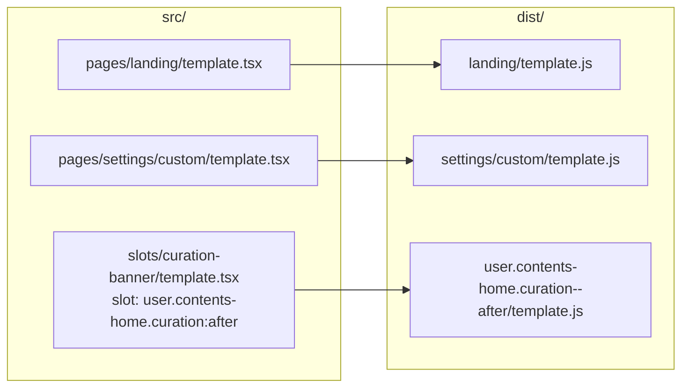

# bstage Template SDK 빌드 시스템

## 1. bstage build 개요

`bstage build`는 `src/pages/`·`src/slots/` 아래의 `template.tsx`를 탐색하여 IIFE 번들(`template.js`)을 생성합니다.

**산출물이 어디로 나가는지는 소스 위치가 정합니다.**



|        | 소스 위치                            | 배치를 정하는 것               | 산출물                       |
| ------ | ------------------------------------ | ------------------------------ | ---------------------------- |
| 페이지 | `src/pages/{경로}/template.tsx`      | 폴더 구조                      | `dist/{경로}/template.js`    |
| 위젯   | `src/slots/{아무 이름}/template.tsx` | `createTemplate`의 `slot` 옵션 | `dist/{슬롯 id}/template.js` |

위젯 산출물 디렉토리는 슬롯 id의 콜론을 `--`로 바꾼 이름입니다 — 콜론은 Windows에서 폴더 이름에 쓸 수 없습니다. 되돌리는 규칙은 core의 `slotIdToDirName` / `dirNameToSlotId`가 소유하며, 관리도구도 같은 함수를 씁니다.

**빌드 파이프라인:**

1. **템플릿 탐색** — `src/pages/`·`src/slots/`를 순회하며 `template.tsx`를 찾습니다. 두 기준 디렉토리 밖은 보지 않습니다 — 폴더 경로가 배포 경로가 되므로 어디서부터 세는지가 정해져 있어야 합니다.
2. **메타데이터 추출** — `metaPlugin`이 소스 코드에서 `createTemplate()` 호출의 옵션 객체를 파싱 (name, slot, type 등). name은 Custom Element 스펙상 소문자 시작 + 하이픈 1개 이상 + 소문자/숫자/하이픈만 허용
3. **Vite 빌드** — IIFE 포맷, React 런타임 포함, CSS를 JS에 인라인, 코드 스플릿 없음
4. **산출물 배치** — 위 표대로 `dist/` 아래로 옮깁니다 (아래 "빌드가 막는 것" 참조)
5. **인증 값 점검** — 번들에 인라인된 `VITE_BSTAGE_*` 값이 온전한지 확인 (아래)

### 빌드가 막는 것

`bstage build`는 `tsc`를 타지 않으므로 타입으로 막았다고 여긴 것이 여기까지 도달합니다. 위치와 옵션이 어긋나면 빌드가 끊습니다.

- `src/pages/` 아래인데 `slot` 옵션이 있음 — 위젯을 페이지 자리에 둔 경우
- `src/slots/` 아래인데 `slot` 옵션이 없음 — 위치만으로는 어느 자리인지 알 수 없음
- `slot` 값이 카탈로그(`SLOT_CATALOG_V2`)에 없음 — 후보를 함께 보여줍니다
- 두 템플릿의 산출물 위치가 겹침
- 두 템플릿의 Custom Element 태그명이 겹침 — 같은 페이지에 함께 로드되면 먼저 등록된 쪽만 살아남아 나중 템플릿이 조용히 앞 템플릿을 그립니다
- 페이지 폴더 이름이 `[id]` 형태 — **동적 경로는 아직 지원하지 않습니다**

`dist/`는 빌드 시작 시 통째로 비웁니다. 폴더를 옮기거나 지운 뒤 다시 빌드해도 옛 산출물이 남지 않습니다.

### 인증 값 점검

Vite 빌드라서 `import.meta.env.VITE_BSTAGE_*`는 **빌드 시점에 문자열로 치환**됩니다. `.env`가 없거나 값이 자리표시자면 그 상태가 그대로 번들에 박히고, 배포 후 401로만 드러납니다. 빌드 시점이 이를 잡을 수 있는 마지막 지점이라 여기서 점검합니다.

- **대상 판정** — 두 조건을 모두 만족할 때만 점검합니다.
  1. 번들에 BstageClient의 앱 ID 헤더(`X-BSTAGE-APP-ID`)가 있을 것. API를 쓰지 않는 UI 전용 템플릿은 `client.ts`를 스캐폴드만 하고 import하지 않으면 트리셰이킹으로 사라지므로 대상이 아닙니다.
  2. 소스가 `import.meta.env.VITE_BSTAGE_*`를 참조할 것. 옛 스캐폴드처럼 `client.ts`에 키를 리터럴로 박은 프로젝트는 `.env`가 없는 게 정상이므로(그 전환은 마이그레이션에서 `선택`) 대상이 아닙니다. 참조한 변수만 검사합니다.
- **검사 항목** — 값 누락, 자리표시자(`YOUR_APP_ID` 등) 잔존, appId·appKey 뒤바뀜, 접두사(`bsa_`/`bsp_`) 불일치. 앱 키는 `VITE_BSTAGE_APP_KEY`(정본)와 옛 이름 `VITE_BSTAGE_APP_SECRET`을 한 값으로 보며, 한쪽만 있으면 빌드가 다른 이름으로도 읽히게 이어 붙인다
- **env 해석** — Vite의 `loadEnv`를 그대로 씁니다. `.env` 파일뿐 아니라 CI가 `process.env`로 주입한 값도 번들에 인라인되므로 파일만 읽으면 오탐이 납니다.
- **빌드를 실패시키지 않습니다** — 값이 비어도 번들 자체는 정상적으로 나오고, 여기서 실패시키면 기존 소비자 CI가 깨집니다. 경고는 빌드 로그 맨 끝에 출력됩니다.
- 어느 환경에서 발급한 키인지(QA 키를 리얼에 썼는지)는 **감지할 수 없습니다** — 키 형식에 발급 환경이 담기지 않습니다. 그 계열은 [GETTING_STARTED.md](./GETTING_STARTED.md) "9.2 배포 전 점검"의 체크리스트가 담당합니다.

---

## 2. Vite 프리셋

```typescript
build: {
  lib: {
    formats: ['iife'],
    name: 'BstageTemplate',
    fileName: () => 'template.js',
  },
  cssCodeSplit: false,                           // CSS를 하나의 에셋으로 모음 (아래 주의 참조)
  rollupOptions: {
    output: { inlineDynamicImports: true },      // 단일 파일 출력
  },
}
```

**각 설정의 근거:**

| 설정                   | 값                                            | 근거                                                                                       |
| ---------------------- | --------------------------------------------- | ------------------------------------------------------------------------------------------ |
| `formats`              | `['iife']`                                    | `<script>` 태그로 직접 로드. 모듈 시스템 불필요                                            |
| `name`                 | `'BstageTemplate'`                            | IIFE 전역 변수명 (실제로는 side-effect로 Custom Element 등록)                              |
| `fileName`             | `'template.js'`                               | 고정 파일명. 호스트는 이 경로를 그대로 로드합니다                                          |
| `cssCodeSplit`         | `false`                                       | CSS를 한 덩어리로 모읍니다. **JS에 인라인되지는 않습니다** — 아래 "CSS는 어떻게 넣나" 참조 |
| `inlineDynamicImports` | `true`                                        | 단일 JS 파일로 출력. CDN에서 1회 로드로 완결                                               |
| `resolve.dedupe`       | `['react', 'react-dom', 'react/jsx-runtime']` | npm link 시 SDK 내부의 React와 템플릿 프로젝트의 React가 각각 번들되는 것을 방지           |

---

### CSS는 어떻게 넣나

템플릿은 Shadow DOM에 마운트되므로 바깥 스타일시트가 적용되지 않습니다. **CSS가 Shadow DOM 안으로 들어가는 경로는 둘뿐입니다.**

| 방법                                   | 배포 산출물 | 로컬 `npm run dev` |
| -------------------------------------- | ----------- | ------------------ |
| `createTemplate`의 `styles` 옵션       | **적용**    | 안 됨              |
| 컴포넌트 안 `<style>{cssText}</style>` | **적용**    | 적용               |
| `import './x.css'`                     | **안 됨**   | 적용               |

```tsx
import css from './style.css?inline'

createTemplate(MyTemplate, { name: 'my-space-hello', styles: css })
```

> **`import './x.css'`는 배포 산출물에서 조용히 사라집니다.** `cssCodeSplit: false`라 Vite가 CSS를 JS에 인라인하지 않고 **별도 `.css` 에셋**으로 내는데(`dist/.staging/{프로젝트}.css`), 빌드는 스테이징에서 `template.js` 하나만 최종 위치로 옮깁니다. 로컬 개발 화면에서는 적용되므로 **"로컬에선 되는데 배포하면 스타일이 없다"**로 나타납니다. CSS 파일로 관리하고 싶다면 `?inline`으로 문자열을 가져와 위 두 경로 중 하나로 넘기세요.

---

## 3. 호스트가 Custom Element 태그명을 아는 법

번들을 로드한 호스트는 `document.createElement(태그명)`으로 마운트해야 하는데, 관리도구는 `templateUrl` 하나만 내려줍니다. 그래서 **번들이 로드되면서 스스로 태그명을 알립니다.**

- 등록 시점(`registerTemplate`)에 `document.currentScript.src`(자기 번들 URL)와 태그명을 전역 `__bstage_elements__`에 남깁니다.
- `document.currentScript`는 스크립트가 동기 실행되는 동안만 유효한데, 템플릿 등록은 IIFE 최상위에서 일어나므로 이 시점에 자기 URL을 알 수 있습니다.
- URL을 키로 씁니다 — `loadTemplatesBySlots`는 여러 번들을 동시에 로드하므로 "로드 전후 증가분"으로 세면 서로 섞입니다.
- `loadTemplate`이 로드 직후 이 값을 조회합니다.
- 조회에 실패하면 **옛 번들 폴백**을 탑니다. 옛 산출물은 디렉토리 이름이 곧 태그명이었으므로(`dist/{name}/`) URL의 디렉토리 세그먼트를 후보로 삼되, 추측으로 쓰지 않고 `customElements.get()`으로 실제 등록됐는지 확인합니다. 확인까지 실패하면 던집니다. 옛 번들이 전부 재배포되면 걷어낼 수 있습니다.

> 예전에는 `manifest.json`이 이 값을 날랐습니다. 호스트 로더는 지금도 manifest를 읽지 않습니다 — 태그명은 위 전역으로 충분합니다. 다만 **포털**이 iframe 격리 판단에 manifest를 쓰므로 0.9.0부터 다시 생성합니다(아래 "manifest.json").

`spaceId` / `type`(user·admin) / `tag`(버전) 같은 상위 경로 세그먼트는 관리도구가 CDN 업로드 단계에서 주입하며, SDK는 관여하지 않습니다. 슬롯 배치와 풀페이지 레이아웃은 관리도구가 소유합니다.

---

## 4. 빌드 산출물 구조

```
dist/
  landing/
    template.js                              ← 페이지 /landing
    manifest.json
  settings/
    custom/
      template.js                            ← 페이지 /settings/custom
      manifest.json
  user.contents-home.curation--after/
    template.js                              ← 위젯
    manifest.json
```

`template.js`는 IIFE 번들 하나입니다(React 런타임 + 컴포넌트 + CSS 인라인).

### manifest.json

`template.js` 옆에 놓입니다. 키 순서·들여쓰기가 고정이라 같은 입력이면 같은 바이트가 나옵니다(앞 네 필드는 예전 CLI가 만들던 것과 같은 모양, `type`만 빠짐. `bridgeProtocol`이 뒤에 붙음).

```json
{
  "elementName": "my-space-hello",
  "entry": "template.js",
  "sdkVersion": "0.9.0",
  "framework": "react",
  "bridgeProtocol": 1
}
```

| 필드             | 값                                                                                                                        |
| ---------------- | ------------------------------------------------------------------------------------------------------------------------- |
| `elementName`    | `createTemplate`의 `name` — 등록되는 Custom Element 태그                                                                  |
| `entry`          | manifest 디렉토리 기준 번들 경로. 항상 `template.js`                                                                      |
| `sdkVersion`     | **번들에 실제로 실린** `@bstage-sdk/core` 버전(CLI 버전 아님). 두 벌 실렸으면 낮은 쪽. 정보용                    |
| `framework`      | `react` 등. 소스에서 못 찾으면 번들에 bstage-react가 실렸는지로 정함                                                      |
| `bridgeProtocol` | 번들에 실린 core가 구현한 격리 브리지 프로토콜 버전. core `package.json`의 `bstage.bridgeProtocol`에서 읽음. 없을 수 있음 |

읽는 쪽은 포털입니다. 게시 빌드를 전개할 때 산출물 디렉토리마다 `bridgeProtocol`·`elementName`을 기록하고, 둘 다 있고 `bridgeProtocol`이 1 이상일 때만 그 템플릿의 iframe 격리를 허용합니다. `sdkVersion`은 게이트에 쓰지 않습니다(정보용). 포털 빌더는 manifest가 있으면 앞 네 필드를 검증해 틀리면 빌드를 실패시킵니다.

> manifest는 **파트너 빌드가 스스로 적는 값**입니다. `bridgeProtocol`은 "이 번들은 격리 프레임에서 돌 수 있다"는 신고일 뿐 보안 근거가 아닙니다 — 격리 자체는 호스트(sandbox iframe·CSP·브리지 정책)가 강제하고, 브리지 호스트 정책은 manifest를 읽지 않습니다. 값이 틀리면 그 템플릿이 프레임 안에서 동작하지 않을 뿐입니다. 반대로 manifest가 없거나 값이 없으면 inline(호스트 origin에서 실행)으로만 배치되므로, 격리를 요구해야 하는 배치는 포털이 fail closed로 다룹니다(배치 거부).

그래서 CLI는 **검증을 통과할 수 없는 manifest는 쓰지 않고 경고만** 냅니다 — 빌드는 성공하고 그 템플릿은 inline으로만 배치됩니다.

- `name`이 포털 규칙 `^[a-z][a-z0-9]*(-[a-z0-9]+)+$`(100자 이하)에 맞지 않을 때 — CLI의 `name` 검증보다 좁습니다(`a--b`, `a-`는 빌드는 되지만 격리 불가)
- 번들에서 bstage-core 버전을 찾지 못했을 때

`bridgeProtocol`은 core가 package.json에 선언합니다.

```json
{ "name": "@bstage-sdk/core", "bstage": { "bridgeProtocol": 1 } }
```

- core의 `bridgeProtocol`은 SDK 런타임 묶음(core·react 어댑터) 전체를 대표합니다. react는 core 버전을 고정하므로 옛 react가 새 core와 실리면 core가 두 벌이 되어 아래 최솟값 규칙이 덮습니다.
- 번들에 core가 여러 벌 실렸으면 **가장 작은 값**을 적습니다.
- 한 벌이라도 값을 모르면(필드가 없는 옛 core, 양의 정수가 아닌 값, package.json으로 귀속하지 못한 사본. 다른 패키지 dist에 미리 번들돼 들어온 core는 구분하지 못합니다) 필드를 **쓰지 않습니다** — 모르는 사본보다 높은 값을 주장하지 않기 위해서입니다. 이때 빌드는 경고만 내고 그 템플릿은 inline으로만 배치됩니다.

페이지 산출물은 경로만큼 중첩됩니다 — 단일 계층이 아닙니다. `spaceId` / `type`(user·admin) / `tag`(버전) 등 상위 경로 세그먼트는 관리도구가 CDN 업로드 시점에 주입하며, SDK는 관여하지 않습니다.

---

## 5. liquid 레포

`public/{user|admin}/{이름}/template.liquid` 로 만드는 레포는 **빌드 단계가 없습니다.** 서버(플랫폼)가 liquid를 렌더하므로 번들링할 것이 없고, 포털이 push된 커밋의 파일을 그대로 패키징합니다.

### `bstage build`는 검증만 합니다

```bash
bstage build          # 산출물 없음 — 문법·규약 검증만
bstage build --json   # { "kind": "liquid", "issues": [...] } 한 덩어리
```

종료코드는 오류가 하나라도 있으면 `2`, 없으면 `0`입니다. `dist/`는 만들어지지 않습니다.

| 수준  | 검사                                                                                                                                                                          |
| ----- | ----------------------------------------------------------------------------------------------------------------------------------------------------------------------------- |
| error | `template.liquid` 문법 오류(줄 번호 표시) · `data.json` JSON 파싱 실패 · 폴더 이름 규칙(`^[a-z][a-z0-9-]*$`) 위반 · liquid 템플릿 0개 · (혼합 레포) sdk 페이지 `user`·`admin` |
| warn  | `public/{user\|admin}/{이름}/` 밖이거나 깊이가 다른 `template.liquid`(포털이 무시) · `layout.json` 존재(포털이 지움) · 폴더에 `template.liquid`가 아닌 이름만 있음            |

같은 검사를 `bstage doctor`도 "liquid 검증" 절에서 보여 줍니다(`--json`의 `liquid.issues`).

### 포털의 패키징 규약

- `public/user/` · `public/admin/` 아래 **한 단계** 폴더만 템플릿으로 인정합니다 — `public/user/events/summer/template.liquid` 는 무시됩니다.
- 그 폴더를 통째로 복사한 뒤 `data.json` · `layout.json` 을 지웁니다. 두 파일은 로컬 프리뷰와 관리도구의 것이라 배포에 나가지 않습니다 — 배포에 필요한 값을 거기 두지 마세요.
- 그 밖의 위치에 있는 `template.liquid` 는 무시합니다.
- sdk(`src/pages` · `src/slots` 의 `template.tsx`)와 섞인 레포(혼합 레포)는 sdk를 빌드한 뒤 liquid를 함께 패키징합니다 — 아래 "혼합 레포"를 참고하세요.
- 배치는 페이지(PAGE)만 가능합니다. 위젯(SLOT) 자리에 liquid 산출물을 붙이면 포털이 400을 냅니다 — `bstage deploy` 가 빌드를 만들기 전에 사전조건 오류로 끊습니다.

로컬에서 화면을 보려면 `bstage dev`를 씁니다(같은 폴더의 `data.json`으로 렌더). 자세한 내용은 [DEV_SERVER.md](./DEV_SERVER.md)를 참고하세요.

### 혼합 레포(sdk + liquid)

한 레포에 `src/pages|slots/**/template.tsx`와 `public/{user|admin}/{이름}/template.liquid`가 함께 있으면 **혼합 레포**입니다. 포털 빌더는 sdk 경로(의존성 설치 → `bstage build`)를 탄 뒤 liquid 폴더를 함께 `dist/{user|admin}/{이름}/`으로 패키징하고, 포털은 산출물 항목마다 종류(`sdk`·`liquid`)를 따로 봅니다.

```bash
bstage build          # sdk 엔트리 번들 + liquid 검증 (dist/에 liquid는 넣지 않음 — 포털이 public/에서 패키징)
bstage build --json   # { "kind": "mixed", "issues": [...], "sdk": { "templates": [...], "outputs": [...] }, "liquid": { "templates": [...] } }
```

- 검증(liquid 문법·규약 + 아래 충돌)을 번들보다 먼저 합니다. 오류가 있으면 번들하지 않고 종료코드 `2`, 번들 실패는 sdk 레포와 같이 `1`입니다.
- **`src/pages/user/…`·`src/pages/admin/…` 페이지는 만들 수 없습니다(대소문자 무시 — `User`도 같습니다).** 산출물이 `dist/user/…`로 나가 liquid 자리와 같은 트리에 놓이고, 같은 디렉터리에 `template.js`와 `template.liquid`가 함께 있으면 포털이 sdk로만 판정해 liquid가 조용히 사라집니다. `bstage build`와 포털 빌더가 모두 여기서 막습니다. 위젯(`src/slots`)은 슬롯 id로 나가므로 해당 없습니다.
- `--json` 동안 진행 로그는 stderr로 나갑니다 — stdout에는 JSON 객체 하나만 있습니다.
- `bstage deploy`는 혼합 레포를 그대로 배포합니다(안내 한 줄). 위젯(SLOT) 배치 사전점검은 liquid 전용 레포에서만 하고, 혼합 레포의 항목별 판정은 포털이 합니다.

liquid 레포를 만드는 것부터 배포까지의 전체 흐름은 [LIQUID.md](./LIQUID.md)에 정리돼 있습니다.

---

## 관련 문서

- [GETTING_STARTED.md](./GETTING_STARTED.md) — 빠른 시작 가이드 (빌드 및 배포 포함)
- [SDK_ARCHITECTURE.md](./SDK_ARCHITECTURE.md) — 단일 번들 출력 설계 원칙
- [DEV_SERVER.md](./DEV_SERVER.md) — 로컬 개발 서버 (빌드 없이 개발)
- [API_REFERENCE.md](./API_REFERENCE.md) — Host 패키지의 loadTemplate 시그니처
- [LIQUID.md](./LIQUID.md) — liquid 템플릿 레포 가이드 (5절의 검증·패키징 규약 포함)
